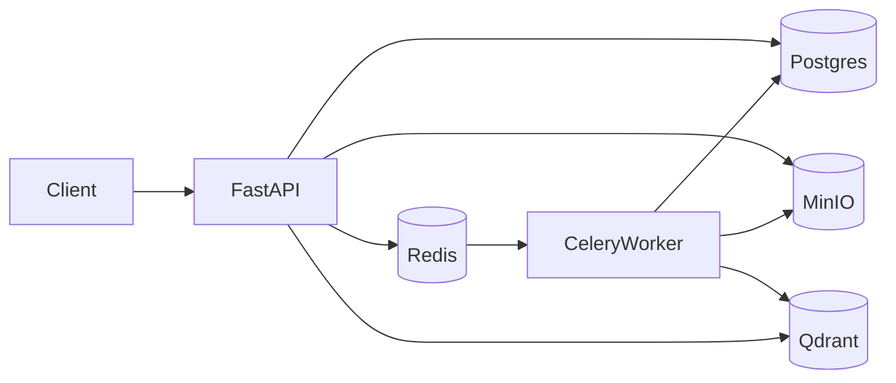

# Visual Search API (FastAPI + CLIP + Qdrant + Celery + MinIO)

End-to-end multimodal visual search:

- Upload images (stored in MinIO) and embed them asynchronously (Celery worker)
- Search by **text** (text-to-image retrieval) or by **image** (image-to-image similarity)
- Store vectors in **Qdrant** and metadata/status in **Postgres**

## Architecture



## Quickstart (Docker)

Prereqs: Docker Desktop

1. Start services:

```bash
docker compose up --build
```

2. Upload an image:

```bash
curl -F "file=@./path/to/image.jpg" http://localhost:8000/images
```

3. Poll status (wait for `ready`):

```bash
curl http://localhost:8000/images/<image_id>
```

4. Search by text:

```bash
curl -X POST http://localhost:8000/search/text -H "Content-Type: application/json" -d "{\"query\":\"a red running shoe\",\"top_k\":5}"
```

## Endpoints

- `POST /images` (multipart): upload + enqueue embedding job
- `GET /images/{image_id}`: status + metadata
- `POST /search/text`: text query → similar images
- `POST /search/image` (multipart): image query → similar images

